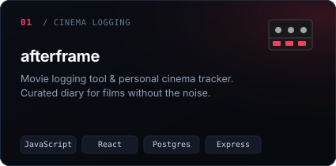
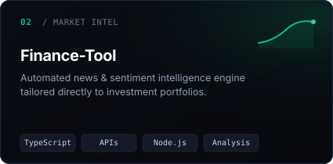
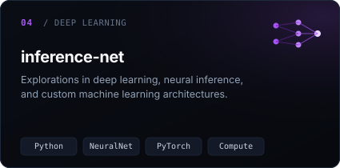
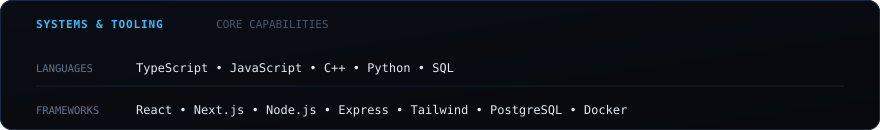

  

 

  
  

  
  

 

  

 

  <a href="https://www.linkedin.com/in/sparsh-jindal-64670930a/">
    <code>linkedin / sparsh-jindal</code>
  </a>
  &nbsp;&bull;&nbsp;
  <a href="mailto:sparshjindal06@gmail.com">
    <code>email / sparshjindal06@gmail.com</code>
  </a>
  &nbsp;&bull;&nbsp;
  <a href="https://github.com/SparshJindal?tab=repositories">
    <code>github / repositories</code>
  </a>

